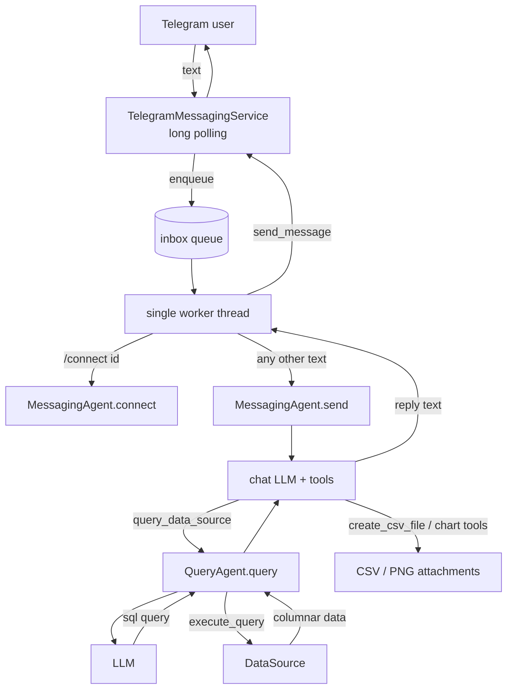

from rag_chatbot.messaging import TelegramMessagingService

# RAG Chatbot

A Telegram chatbot that answers natural-language questions about a database. An LLM translates each question into SQL, the SQL runs against the data source (CSV files through DuckDB today), and the bot replies with text, a chart, or a CSV export.

## Contents

1. [How it works](#1-how-it-works)
2. [Setup](#2-setup)
3. [Configuration reference](#3-configuration-reference)
4. [Adding new implementations](#4-adding-new-implementations)
5. [Project layout](#5-project-layout)
6. [Current limitations](#6-current-limitations)

---

## 1. How it works

The name says RAG, but there is no vector search. The "retrieval" is grounding: each SQL-generation prompt contains the data source's **overview** (free text), its **specification** (tables, columns, types, human-written descriptions) and the user's question.



### The pieces

| Component | Responsibility |
|---|---|
| `MessagingService` (base) | Inbox queue and worker thread, commands (`/connect`), per-user history, timeout/error apologies. Platform independent. |
| `TelegramMessagingService` | Only Telegram specifics: long polling, parsing updates, sending text, photos and documents. |
| `MessagingAgent` | The conversational agent. Owns the chat LLM, the tools it can call, the current data source and the last query result. |
| `QueryAgent` (base) | Natural language to query. Runs the retry loop (up to `ATTEMPT_LIMIT` attempts), parses the query LLM's response, executes the query and builds a `QueryResponse`. |
| `CSVQueryAgent` | Supplies the implementation-specific prompt. |
| `DataSource` (base) | Connection lifecycle, `execute_query`, `get_specification`, `get_overview`. |
| `CSVDataSource` | Exposes one CSV file as a SQL view through DuckDB. |
| `BaseLLM` / `OllamaLLM` | Provider abstraction. `OllamaLLM` implements the tool-calling loop against Ollama's `/api/chat`. |
| `ComponentFactory` | Builds everything from `config.yaml` and `data_sources.json` using type registries. |

### One conversational turn

1. A Telegram update is turned into a `Message` and **enqueued**. Receiving never waits for the LLM.
2. A single **worker** takes messages in arrival order. A `/connect <id>` message goes to `MessagingAgent.connect`. Anything else is appended to that user's history and sent to `MessagingAgent.send`.
3. The agent builds a prompt (internal state plus the conversation) and calls its LLM. The system prompt is sent as a real system message.
4. The LLM may call tools. `query_data_source` asks the `QueryAgent`, which asks a second LLM for `{"can_answer": true, "sql": "..."}`, runs the SQL and returns the result. If parsing or execution fails, the error is appended to the prompt and the LLM tries again.
5. **Small results** (up to 10 rows) are pasted back to the chat LLM. **Large results** are *not*: the LLM only sees row count, column names and descriptions, and can call `create_csv_file`, `column_chart_tool`, `pie_chart_tool`, `line_chart_tool` or `histogram_tool` with column names. The data itself stays in the agent's memory.
6. The reply text and any generated files go back through `send_message`. If the LLM times out or anything fails, the user gets a short apology instead of silence.

### Two LLMs

The chat LLM (`messaging_agent.llm`) talks to the user and calls tools. Each data source has its own `llm` block for SQL generation, so you can use a different model or temperature (SQL generation uses `temperature: 0.0`). Each agent installs its own system prompt on its own LLM, so **never share one LLM instance between two agents**. The factory creates separate instances.

---

## 2. Setup

### Prerequisites

- Python 3.12 or newer (the Docker image uses 3.12).
- A running [Ollama](https://ollama.com) server with the model pulled: `ollama pull gemma4:26b`. A 26B model needs a GPU with enough memory, or a lot of patience on CPU. Use a smaller model if needed.
- A Telegram bot token from [@BotFather](https://t.me/BotFather).

### Install

```bash
python -m venv .venv
source .venv/bin/activate
pip install -r requirements.txt   # requests, pyyaml, duckdb, matplotlib, python-dotenv
```

### Configure

You need four kinds of files.

**`.env`** holds secrets and is never committed:

```
TELEGRAM_BOT_TOKEN=123456:ABC...
OLLAMA_BASE_URL=http://localhost:11434
DEBUG_OPTION=FALSE
```

`DEBUG_OPTION=TRUE` turns on DEBUG logging.

**`config.yaml`** describes the chat stack:

```yaml
messaging_agent:
  csv_output_dir: /app/output/csv
  chart_output_dir: /app/output/charts
  db_config_path: /app/config/data_sources.json
  llm:
    type: ollama
    model: gemma4:26b
    base_url: ${OLLAMA_BASE_URL}
    request_timeout: 300

messaging_service:
  type: telegram
  token: ${TELEGRAM_BOT_TOKEN}
  max_queue_size: 50
```

A string written exactly as `${NAME}` is replaced by the environment variable `NAME`. Startup fails with a clear error if it is not set. Use this for every secret.

**`data_sources.json`** lists the sources users can connect to:

```json
{
  "data_sources": {
    "clinical": {
      "type": "csv",
      "csv_path": "/app/data/clinical/clinical_data.csv",
      "overview_path": "/app/data/clinical/overview.txt",
      "specification_path": "/app/data/clinical/specs.yaml",
      "llm": {
        "type": "ollama",
        "model": "gemma4:26b",
        "base_url": "${OLLAMA_BASE_URL}",
        "temperature": 0.0
      }
    }
  }
}
```

**Per-source files:**

- `overview.txt`: a few paragraphs of plain text saying what the data is, what each row represents, units, and any quirks. Quality here directly drives answer quality.
- `specs.yaml`: A specification file is meant to provide context on what is each attribute of a data representation. 
Since this is very platform-specific, the specs extraction is delegated to the specific DataSource implementation for each type of database.

For a CSV database, we use a plain map of table column descriptions, keys must match the CSV header **exactly**, including case and spaces:

  ```yaml
  First Name: Given name of the user
  Date of birth: Birth date in YYYY-MM-DD format
  Job Title: Current professional role or occupation
  ```

  Columns missing from the file are allowed and get no description. Quote values that contain `: `.

### Run locally

```bash
python main.py
```

`main.py` loads `.env`, configures logging, builds the stack with `ComponentFactory.build_messaging_service(...)` and calls `run_forever()`. Stop it with Ctrl+C: the in-flight answer gets 5 seconds to finish and any queued messages are discarded (the log says how many).

### Run with Docker

Ollama is treated as an external service. The only link is `OLLAMA_BASE_URL`.

There are three volumes, one for configuration files, one for data files (where we save the csv databases, overview files, specs files, etc.),
and one for output files (csv files and charts).

```yaml
# docker-compose.yml
services:
  bot:
    build: .
    restart: unless-stopped
    env_file: .env
    environment:
      CONFIG_PATH: /app/config/config.yaml
      OLLAMA_BASE_URL: ${OLLAMA_BASE_URL:?Set OLLAMA_BASE_URL in .env}
    extra_hosts:
      - "host.docker.internal:host-gateway"   # Linux, when Ollama runs on the host
    volumes:
      - ./config:/app/config:ro
      - ./data:/app/data:ro
      - bot_output:/app/output

volumes:
  bot_output:
```

```bash
docker compose up -d --build
docker compose logs -f bot
docker compose stop
```

### Use the bot

1. Open your bot in Telegram and send `/connect id` (any id from `data_sources.json`).
2. Ask questions: *"How many people are there per job title?"*, *"Chart the 10 most common job titles"*, *"Export everyone born after 1990 to CSV"*.
3. Use `/connect <other id>` to switch data sources. This resets the previous query state.

Until a source is connected, the bot answers "Please select a data source".

---

## 3. Configuration reference

### `messaging_agent`

| Key | Default | Meaning |
|---|---|---|
| `llm` | required | The chat LLM block (see below). |
| `csv_output_dir` | `./output/csv` | Where CSV exports are written. |
| `chart_output_dir` | `./output/charts` | Where chart PNGs are written. |
| `db_config_path` | none | JSON file of connectable data sources. Needed for `/connect`. |
| `system_prompt` | built-in | Replaces the default prompt of the chat LLM. |

### `messaging_service` (Telegram)

| Key | Default | Meaning |
|---|---|---|
| `type` | required | `telegram` |
| `token` | required | Bot token. Use `${TELEGRAM_BOT_TOKEN}`. |
| `poll_interval` | `1.0` | Seconds between polls. |
| `poll_timeout` | `30` | Telegram long-poll timeout in seconds. |
| `max_queue_size` | `50` | Waiting messages before users get a "busy" reply. `0` is unbounded. |

### `llm` (type `ollama`)

| Key | Default | Meaning |
|---|---|---|
| `model` | required | Ollama model name. |
| `base_url` | `http://localhost:11434` | Ollama server. |
| `temperature` | model default | Sampling temperature. Use `0.0` for SQL generation. |
| `request_timeout` | `300` | Seconds per HTTP request (per chat round trip, not per answer). The first request after Ollama starts loads the model and can be slow. |
| `max_tool_iterations` | `10` | Cap on tool-calling rounds before forcing a final answer. |
| `system_prompt` | none | Overridden by the agent that owns this LLM. |

### Data source (type `csv`)

| Key | Default | Meaning |
|---|---|---|
| `csv_path` | required | The CSV file. |
| `overview_path` | required | Plain-text description of the data. |
| `specification_path` | `""` | YAML column descriptions. |
| `table_name` | `data` | Name of the SQL view. Must be a plain identifier. |
| `csv_read_options` | none | Extra options for DuckDB's `read_csv_auto`, e.g. `{"delim": ";"}`. |
| `query_agent_type` | same as `type` | Which `QueryAgent` to use. |
| `llm` | required | The SQL-generation LLM block. |

---

## 4. Adding new implementations

`ComponentFactory` has one registry per component type. The `type` key in the config selects the class, and **all other keys are passed as constructor arguments**, so constructor parameter names are the config keys. To add an implementation: write the class, then register it.

```python
class ComponentFactory:
    MESSAGING_SERVICE_REGISTRY = {"telegram": TelegramMessagingService, "whatsapp": WhatsAppMessagingService}
    LLM_REGISTRY               = {"ollama": OllamaLLM, "openai": OpenAILLM}
    DATA_SOURCE_REGISTRY       = {"csv": CSVDataSource, "postgresql": PostgresDataSource}
    QUERY_AGENT_REGISTRY       = {"csv": CSVQueryAgent, "postgresql": PostgresQueryAgent}
```

### A new LLM provider

Subclass `BaseLLM` and implement `send`. The tool-calling loop is yours because every API represents tool calls differently.

```python
class OpenAILLM(BaseLLM):
    def __init__(self, model, api_key, tools=None, system_prompt=None, request_timeout=120):
        super().__init__(model=model, source="openai", tools=tools, system_prompt=system_prompt)
        ...

    def send(self, prompt: str) -> LLMResponse:
        # 1. Messages: self.system_prompt (if set) as the system message, prompt as the user message.
        # 2. Call the API, advertising self.tools (each Tool has .to_schema()).
        # 3. While the reply requests tools: self._execute_tool(name, **arguments),
        #    append the results, call again (cap the rounds).
        #    Catch tool errors and return them to the model as the tool result,
        #    but let LLMTimeoutError propagate.
        # 4. Return LLMResponse(content=..., tool_calls=None).
        # Raise LLMTimeoutError when the provider times out.
```

Config: `{"type": "openai", "model": "...", "api_key": "${OPENAI_API_KEY}"}`.

### A new data source (for example PostgreSQL)

Two classes: a `DataSource` that talks to the backend and a `QueryAgent` that knows its query language.

```python
class PostgresDataSource(DataSource):
    def __init__(self, overview_path, specification_path="", credentials=None, ...): ...
    def connect(self) -> bool: ...        # return False on expected failures, don't raise
    def close(self) -> None: ...
    def execute_query(self, query: str) -> ColumnarData: ...   # read-only; {column: [values]}
    def get_specification(self) -> Specification: ...
        # {table: {column: {"type": "...", "description": "..." | None}}}
        # A single-table backend returns one entry, PostgreSQL one per table.
```

```python
class PostgresQueryAgent(QueryAgent):
    default_system_prompt = "You are an expert PostgreSQL analyst. ..."
    # query_key = "sql"  (change if the LLM should return another kind of query)

    def _build_prompt(self, natural_language_query, specification) -> str:
        # overview + schema + self._response_format_instructions("SELECT ... FROM ...")
        # + the user's question + dialect tips.

    def _describe_columns(self, data, specification) -> Dict[str, str]:
        # Map each result column to a description ("" when unknown).
```

`QueryAgent` already handles the retry loop, JSON parsing and building the response. Subclasses only supply the prompt and the descriptions.

Specification files stay backend-specific. CSV uses a flat `{column: description}` map. A multi-table source should use `{table: {column: description}}`.

### A new chat platform (for example WhatsApp)

Subclass `MessagingService` and implement two methods. Queueing, commands, history and error handling come from the base class.

```python
class WhatsAppMessagingService(MessagingService):
    def __init__(self, messaging_agent, ..., max_queue_size=50):
        super().__init__(messaging_agent, max_queue_size)

    def _receive_loop(self) -> None:
        while not self.stopped:
            for event in ...:   # poll or serve a webhook
                self.on_message_received(
                    Message(user_id=..., source=MessageSource.USER, message=text)
                )

    def send_message(self, message: Message) -> None:
        # Deliver message.message plus message.image_paths and message.file_paths.
```

### A new tool for the chat agent

Add a method to `MessagingAgent` and register it in `_register_tools()` with a JSON-schema `parameters` dict. Tools that work on large results should take **column names** and read from the last query result instead of taking the data as an argument. That is what keeps big tables out of the LLM's context.

---

## 5. Project layout

```
main.py                         entry point
config/
  config.yaml                     chat stack configuration
  data_sources.json               connectable data sources
data/<source>/                  CSV, overview.txt, specs.yaml
rag_chatbot/
  agent/messaging_agent.py      MessagingAgent: tools, prompt, connect
  config/                       ComponentFactory and registries
  data_source/base.py, csv.py   DataSource, CSVDataSource (DuckDB)
  llm/base.py, ollama.py        BaseLLM, OllamaLLM, LLMTimeoutError
  messaging/base.py, telegram.py  MessagingService, TelegramMessagingService
  query/base.py, csv.py         QueryAgent, CSVQueryAgent
  models.py                     Message, MessageHistory, QueryResponse, Tool, ...
```

---

## 6. Current prototype limitations

### Security

- **Weak SQL guard.** `CSVDataSource` only checks that the statement *starts with* `SELECT` or `WITH`. Stacked statements (`SELECT 1; DROP VIEW data`) pass, and DuckDB table functions such as `read_csv('/etc/passwd')` can read any file the process can see. The SQL comes from an LLM that is steered by user text, so prompt injection is a realistic attack.
- **No authentication or authorization.** Any Telegram user who finds the bot can talk to it and `/connect` to **any** configured source, including sensitive ones.
- **Sensitive data handling is undefined.** No audit trail, no retention policy, no per-source access rules. DEBUG logs contain questions and generated SQL.
- **Secrets** come from environment variables, which is a start but not a secret manager.

### Architecture

- **One shared agent for everyone.** `MessagingAgent` keeps a single connected data source, a single "last query result" and a single attachment list. `/connect` from one user changes the data source for **all** users. This could be solved by implementing a session manager.
- **One conversation at a time.** A single worker answers messages sequentially. One slow query delays everyone, and one user can fill the queue. A worker pool design pattern is suggested to solve this issue.
- **State lives in memory.** Conversation histories and the queue are lost on restart. Histories also grow without limit and are pasted whole into every prompt, so long conversations will exceed the model's context window. A database should store temporarily the users' messages.
- **Messages can be lost.** Telegram's update offset is advanced before the answer is produced, so a crash or shutdown drops queued and in-flight messages.

### Answer quality

- **Text-to-SQL is unreliable on small models.** There is no validation beyond "it ran", no test set, and no measure of how often answers are right. Wrong-but-plausible answers are the main risk.
- **No value awareness.** The LLM sees column names, types and descriptions, but not the actual categories, so it guesses spellings like `'Male'` versus `'M'`.
- **The whole schema goes into every prompt.** Fine for one table, not for wide or multi-table schemas.

### Product and operations

- **CSV only**, loaded when you `/connect`. Edits to the file are not picked up until reconnecting.
- **Telegram polling, text only.** No webhooks, no incoming files or voice, replies over 4096 characters fail to send, and the user gets no "typing" or queue-position feedback.
- **Generated files are never deleted.** Charts and CSVs pile up in the output directory.

---
